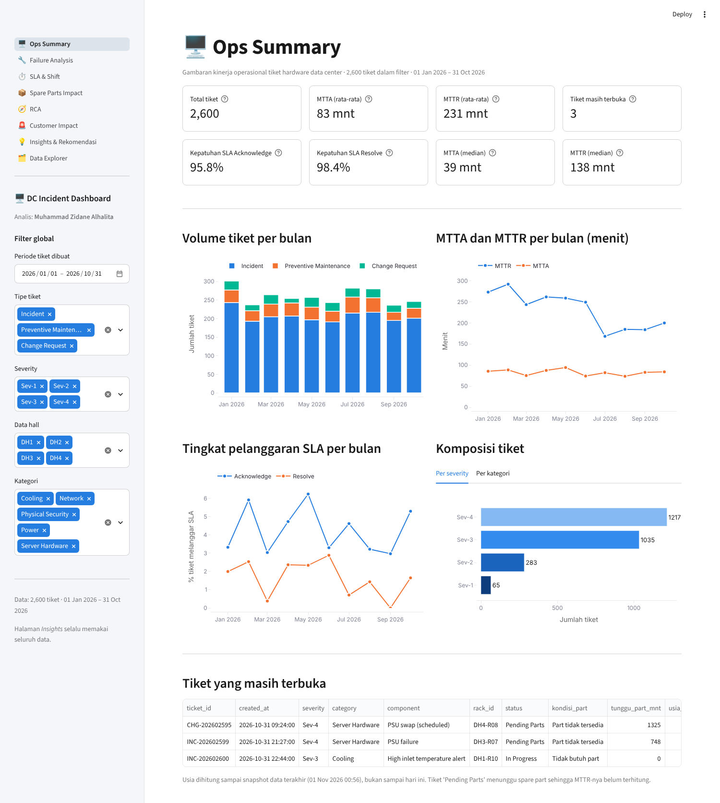
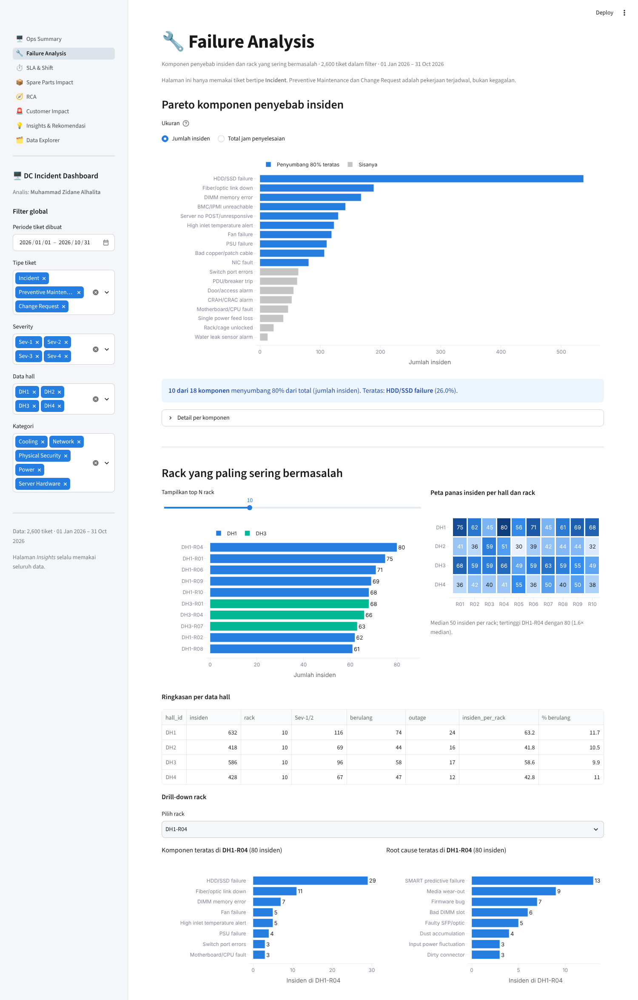
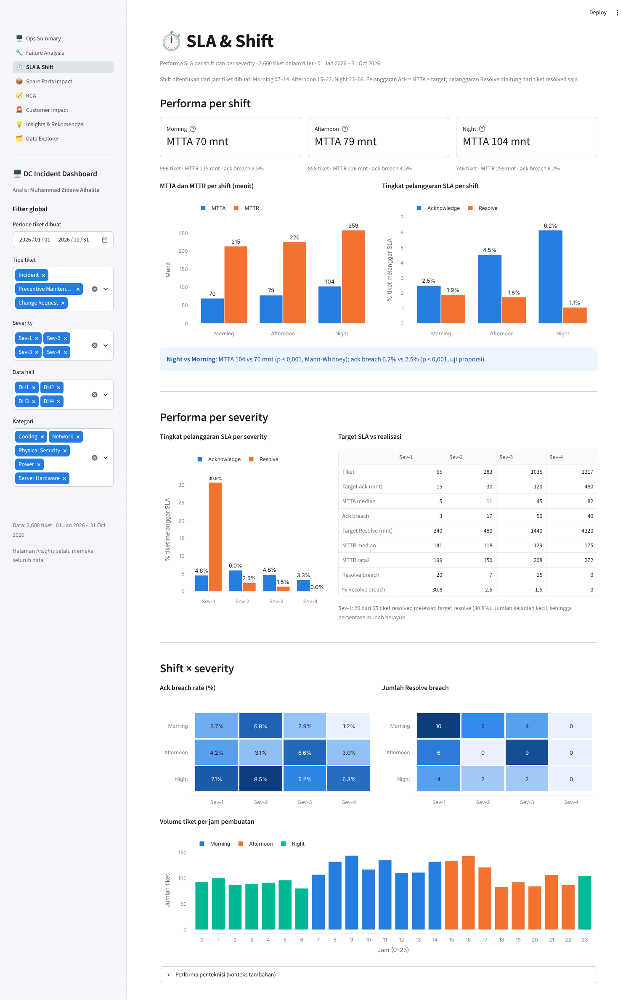
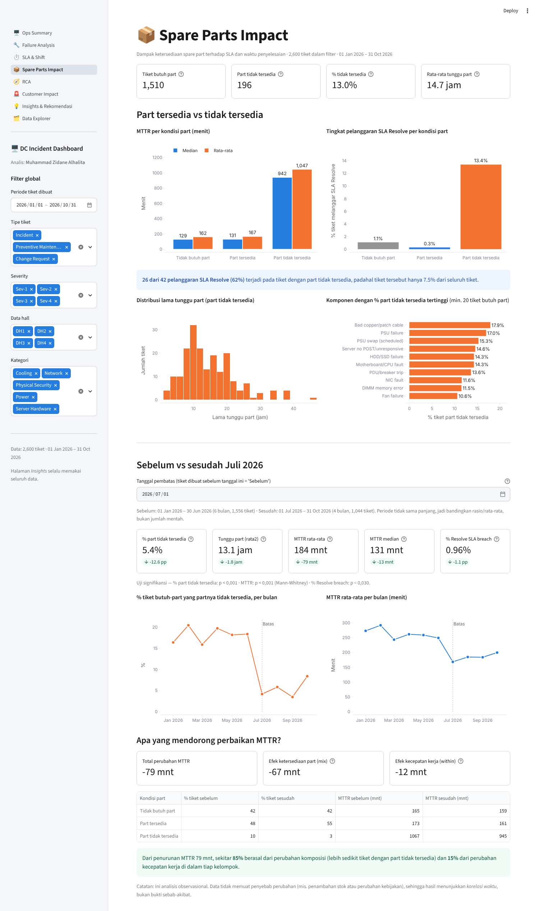
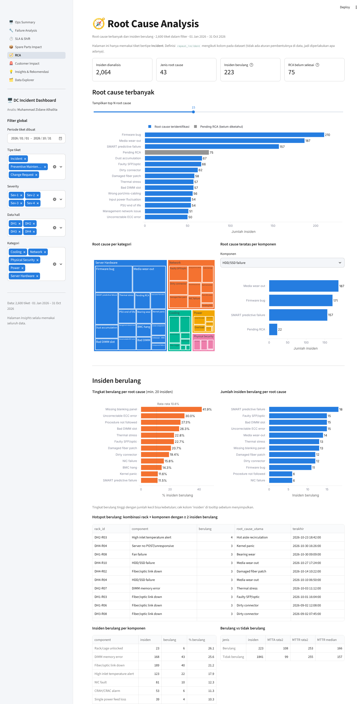
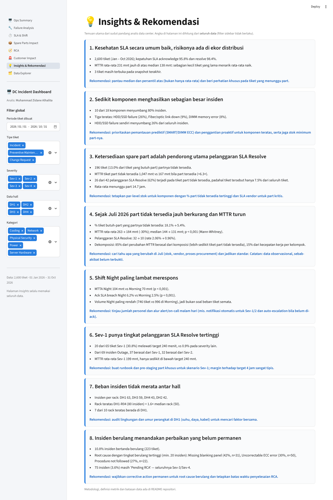

# 🖥️ Data Center Hardware Incident Dashboard

Dashboard analitik interaktif (Streamlit + Plotly) untuk menganalisis tiket insiden hardware data center:
kinerja operasional, penyebab kegagalan, SLA per shift/severity, dampak ketersediaan spare part
(termasuk perbandingan sebelum/sesudah Juli 2026), serta root cause dan insiden berulang.

**Dibuat oleh:** Muhammad Zidane Alhalita — Data Center Analyst

## Halaman

| Halaman | Isi |
|---|---|
| **Ops Summary** | Total tiket, MTTA/MTTR (rata-rata & median), kepatuhan SLA acknowledge/resolve, tiket yang masih terbuka, tren bulanan |
| **Failure Analysis** | Pareto komponen penyebab insiden (jumlah atau total jam penyelesaian), top rack bermasalah, peta panas hall × rack, drill-down rack |
| **SLA & Shift** | Performa per shift dan per severity, target vs realisasi, heatmap shift × severity, volume per jam, tabel teknisi |
| **Spare Parts Impact** | Dampak part tersedia/tidak tersedia ke MTTR dan SLA, komponen paling sering kehabisan part, **sebelum vs sesudah Juli 2026** + dekomposisi penyebab perubahan MTTR |
| **RCA** | Root cause terbanyak, treemap per kategori, tingkat insiden berulang, hotspot rack × komponen, tindak lanjut *Pending RCA* |
| **Customer Impact** *(tambahan)* | Outage/Degraded, komponen penyebab Outage, eskalasi |
| **Insights & Rekomendasi** *(tambahan)* | 8 temuan utama beserta rekomendasi, angkanya dihitung langsung dari data |
| **Data Explorer** *(tambahan)* | Telusuri tiket mentah, pilih kolom, unduh CSV |

Filter global di sidebar (periode, tipe tiket, severity, data hall, kategori) berlaku di semua halaman kecuali *Insights*.

## Screenshot

| | |
|---|---|
|  |  |
|  |  |
|  |  |

## Temuan utama

Data: 2.600 tiket dibuat 1 Jan – 31 Okt 2026 (2.064 di antaranya Incident).

1. **SLA secara umum sehat**: kepatuhan acknowledge 95,8% dan resolve 98,4%. MTTR rata-rata 231 mnt jauh di atas median 138 mnt karena ekor distribusi yang panjang.
2. **Pareto komponen**: 10 dari 18 komponen menyumbang 80% insiden; HDD/SSD failure sendiri 26%.
3. **Spare part adalah pendorong utama pelanggaran SLA Resolve**: tiket dengan part tidak tersedia hanya 7,5% dari seluruh tiket, tetapi menyumbang 26 dari 42 (62%) pelanggaran. MTTR-nya ≈ 6× lebih lama (1.047 vs 167 mnt).
4. **Sebelum vs sesudah Juli 2026**: % part tidak tersedia turun 18,1% → 5,4%, MTTR rata-rata 263 → 184 mnt (−30%), pelanggaran SLA Resolve 32 → 10. Dekomposisi menunjukkan ±85% penurunan MTTR berasal dari berkurangnya tiket tanpa part (efek komposisi), bukan karena pengerjaan per tiket menjadi jauh lebih cepat. *Ini analisis observasional — penyebab perubahannya tidak ada di data.*
5. **Shift Night paling lambat merespons**: MTTA 104 vs 70 mnt (Morning); ack breach 6,2% vs 2,5% (keduanya p < 0,001) padahal volumenya paling rendah.
6. **Sev-1**: 20 dari 65 tiket (30,8%) melewati target resolve 4 jam, jauh di atas severity lain.
7. **Hall DH1** memiliki beban tertinggi (63 insiden/rack vs 42 di DH2); 7 dari 10 rack teratas ada di DH1.
8. **Insiden berulang** 10,8%; tertinggi pada *Missing blanking panel* (42%), *Uncorrectable ECC error* (30%). 75 insiden masih *Pending RCA*.

## Menjalankan secara lokal

```bash
python -m venv .venv
source .venv/bin/activate        # Windows: .venv\Scripts\activate
pip install -r requirements.txt
streamlit run app.py
```

Dashboard terbuka di http://localhost:8501. Dikembangkan dan diuji dengan Python 3.13, Streamlit 1.67, pandas 3.0, Plotly 7.2.

Menjalankan tes (memverifikasi angka KPI terhadap perhitungan independen):

```bash
pip install pytest
pytest
```

## Deploy ke GitHub dan Streamlit Community Cloud

```bash
cd dc-incident-dashboard
git init
git add .
git commit -m "Initial commit: DC incident dashboard"
git branch -M main
git remote add origin https://github.com/<username>/<nama-repo>.git
git push -u origin main
```

Lalu di <https://share.streamlit.io>: **Create app** → pilih repositori → *Main file path*: `app.py` → **Deploy**.
Dependensi dibaca otomatis dari `requirements.txt`; dataset (±620 KB) sudah ikut di folder `data/`.

## Struktur proyek

```
├── app.py                 # entry point: filter global + navigasi halaman
├── requirements.txt
├── .streamlit/config.toml # tema
├── data/                  # dataset CSV
├── src/
│   ├── data.py            # load, validasi kolom, kolom turunan, filter
│   ├── metrics.py         # KPI, ringkasan grup, Pareto, uji statistik, dekomposisi MTTR
│   ├── theme.py           # palet warna, gaya Plotly, format angka
│   └── views/             # satu modul per halaman
├── tests/test_metrics.py
└── docs/screenshots/
```

## Definisi metrik dan catatan data

- **MTTA** = `acknowledged_at − created_at`, semua tiket. **MTTR** = `resolved_at − created_at`, hanya tiket *Resolved*.
- **Kepatuhan SLA Ack** = 1 − (tiket ack breach / semua tiket). **Kepatuhan SLA Resolve** = 1 − (resolve breach / tiket resolved); tiket terbuka belum dievaluasi sehingga tidak masuk penyebut. Flag breach mengikuti kolom dataset (Ack breach berlaku bila MTTA ≥ target).
- **Tiket terbuka** = `status ≠ Resolved` (2 *Pending Parts*, 1 *In Progress*). Usianya dihitung sampai snapshot data terakhir (1 Nov 2026 00:56), bukan sampai hari ini.
- **Shift** mengikuti kolom `shift` (berdasarkan jam tiket dibuat: Morning 07–14, Afternoon 15–22, Night 23–06).
- **Failure Analysis dan RCA** hanya memakai tiket bertipe *Incident*; *Preventive Maintenance* dan *Change Request* adalah pekerjaan terjadwal.
- **Kondisi part**: *Tidak butuh part*, *Part tersedia*, *Part tidak tersedia* (dari `spare_part_required` dan `spare_part_available`).
- **Sebelum/sesudah Juli 2026**: berdasarkan `created_at` < / ≥ 1 Juli 2026 (tanggal pembatas bisa diubah di halaman). Periode sebelum 6 bulan, sesudah 4 bulan, sehingga yang dibandingkan adalah rasio/rata-rata. Uji signifikansi: uji proporsi dua sampel dan Mann-Whitney U.
- **`repeat_incident`** dipakai apa adanya dari dataset; aturan pembentuknya tidak tersedia.
- Jumlah kejadian pada beberapa irisan kecil (mis. Sev-1, n = 65) membuat persentase mudah berayun; jumlah mentah ditampilkan di tooltip/tabel.

## Lisensi

MIT — lihat [LICENSE](LICENSE).
